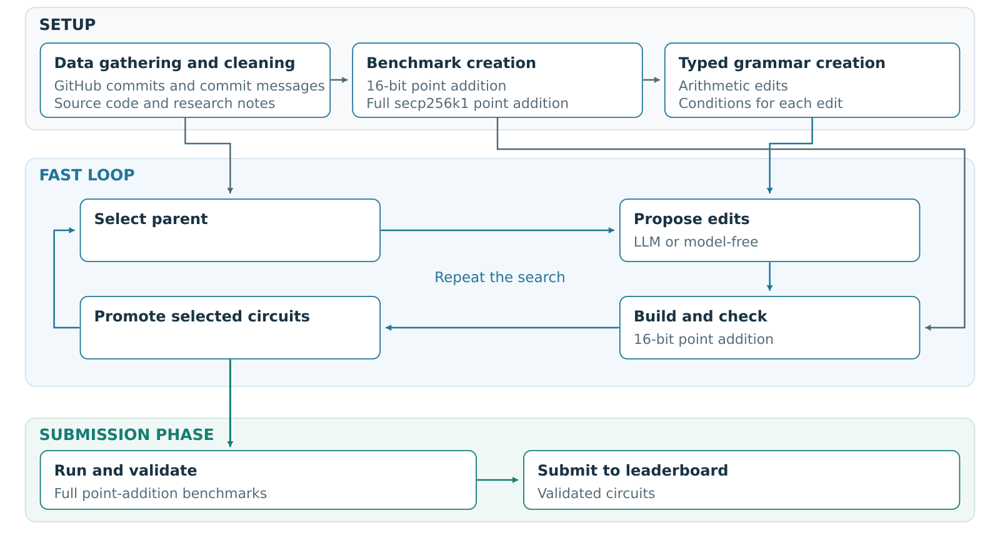

# Quantum Circuit Optimiser

[](https://github.com/SnehalRaj/quantum-circuit-optimiser/actions/workflows/checks.yml)
[](LICENSE)
[](paper/LLM_Assisted_Quantum_Circuit_Optimisation.pdf)

A research harness for reversible quantum circuits, with typed edit rules, model-free search, optional LLM guidance, and independent circuit checks.
The experiments target elliptic-curve point addition for the [ECDSA.fail benchmark](https://ecdsa.fail).

**[Read the manuscript](paper/LLM_Assisted_Quantum_Circuit_Optimisation.pdf)** · [Rebuild the paper](paper/README.md) · [Use the harness](docs/USAGE.md) · [Cite this work](CITATION.cff)



Rust constructs and checks circuits. Python manages proposals, source versions, and experiment records.
The fast stage checks full point addition over a 16-bit field.
Full-width experiments use secp256k1 constructors.
The checker tests output coordinates, phase, scratch, and addend preservation.

## Results

At **12:05 UTC on 26 October 2026**, our circuits hold **46 of 215 public frontier points (21.4%)**.
A frontier point has no public competitor with no more qubits and no more Toffolis, with a strict saving in at least one.
Of our 52 measured submissions, 46 remain on that frontier.
The submissions use deterministic compiler and layout edits within inherited circuit families.

| Circuit family | Changes | Measured commits / frontier points | Largest Toffoli saving | Largest qubit saving |
|---|---|---:|---:|---:|
| Froghop: packed inversion | Cleanup, exact gate replacements, workspace allocation | 45 / 44 | 271,963 | 6 |
| Leapfrog | Approximation tuning after reliability repair | 1 / 0 | 63,584 | 22 |
| SKY-COF: shared cofactors | Gate replacements and cofactor storage | 6 / 2 | 1,119 | 6 |

Savings compare each circuit with its declared parent; Leapfrog uses our repaired local control.
The two maxima can describe different circuits and involve resource trade-offs.
The largest Froghop Toffoli saving adds 20 qubits. Its largest qubit saving adds 1,811,710 Toffolis.
The largest SKY-COF qubit saving adds 85,793 Toffolis.
See the [family records](paper/data/own-submission-families.json) for every comparison.

Our lowest-product submission uses **1,270 qubits and 793,798 Toffolis**, giving **QT = 1,008,123,460**.
On the same 32,768 inputs, it fails 9 inputs versus 81 for the fixed 24 October comparator.
The paper defines the failure checks and reports the larger confirmation audit.

A separate controlled study compares search methods over **16 edit combinations on one 16-bit point-addition constructor**.
Each method gets eight proposals in each of five runs.
The table reports median QT reductions from the same prepared parent.

| Search method | After 1 proposal | After 4 proposals | After 8 proposals | Runs finding the best circuit by 8 |
|---|---:|---:|---:|---:|
| Random search | 6.27% | 18.43% | 18.43% | 0/5 |
| Evolution | 7.77% | 17.57% | 18.60% | 4/5 |
| Claude Opus 5.5 | 17.57% | 18.60% | 18.60% | 5/5 |
| GPT 6.1 Sol | 11.51% | 18.60% | 18.60% | 5/5 |

Model guidance finds good combinations earlier in this finite search space.
Evolution reaches the same median after eight proposals.
All 17 evaluated circuits pass fresh joint audits on 16,384 inputs and two measurement streams.
The [study records and verifier](studies/point-addition-search-20261026/README.md) retain proposals, calls, and audit outcomes.

## Quick start

Use Python 3.10 or later and Rust 1.93.0. The source launcher uses Python's standard library.

```sh
git clone https://github.com/SnehalRaj/quantum-circuit-optimiser.git
cd quantum-circuit-optimiser
rustup toolchain install 1.93.0 --profile minimal
./lco --help
./lco doctor
./lco verify-data
./lco setup
./lco family list
```

Run a source-backed search with a model-free proposer:

```sh
./lco search --family qualified-leapfrog --targets ap1270 \
  --config configs/offline.json --trials 4 \
  --small-pairs 4096 --large-pairs 16384 \
  --out work/leapfrog
```

For Claude or Codex guidance, use `configs/claude.json` or `configs/codex.json` after you authenticate through the provider CLI.
The [harness guide](docs/USAGE.md) covers grammar composition, editable families, resume, and submission exports.
Froghop circuit generation can use about 12 GB of memory; run large emissions in sequence.
The Python module retains the name `llm_circuit_optimiser` for compatibility.

## Reproduce and check

```sh
PYTHONPATH=src python3 -m unittest discover -s tests -v
cargo +1.93.0 test --release --locked --manifest-path native/Cargo.toml
./lco verify-data
```

The [paper directory](paper/) contains the latest manuscript, LaTeX, figures, frozen public snapshot, and saved experiment evidence.
Its build recounts 557,056 saved stream verdicts without model calls or new circuit runs.
The [reconstruction catalog](data/targets/) contains 14 pinned Froghop recipes and a Leapfrog recipe.
Historical receipts identify their source versions; they have separate scope from the 46-point frontier snapshot.

- [Grammar contracts](docs/GRAMMAR.md) and [learned-rule interface](docs/LEARNED-RULES.md)
- [Frontier campaign guide](docs/FRONTIER-CAMPAIGN.md)
- [Fine-tuning study and its limits](studies/historical/finetuning/README.md)
- [Contributing](CONTRIBUTING.md) and [source-sharing checks](docs/SHARING.md)

## License, credit, and AI disclosure

Original project code uses the [Apache License 2.0](LICENSE).
Retained upstream code keeps its existing notices and terms. See [NOTICE](NOTICE) and the notices under `vendor/`.
Please cite [CITATION.cff](CITATION.cff) or [citation.bib](citation.bib), plus the upstream sources used in your work.

GPT-6 helped write the manuscript. Claude Opus and GPT-6 helped develop the research harness.
